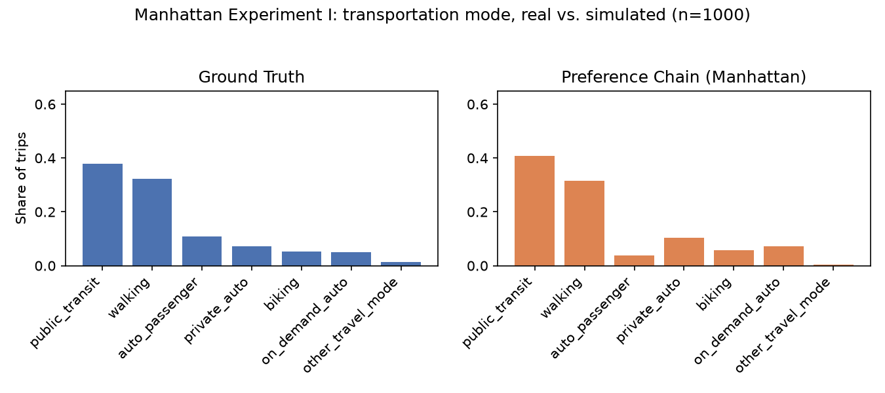
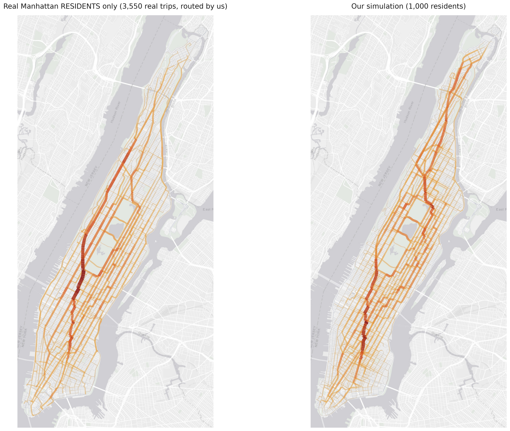

# Simulating Manhattan

This project validates an LLM-based synthetic mobility population, built with a Graph RAG /
"Preference Chain" architecture, against real mobility data for Manhattan, NY.

**Approach**: the code release for *"Graph RAG as Human Choice Model: Building a
Data-Driven Mobility Agent with Preference Chain"* (Kai Hu et al. 2025, arXiv:2508.16172)
only validates on Cambridge, MA and San Francisco, CA. This project fixed [8 blocking
bugs](#bug-fixes), built a full data pipeline sourcing real Replica, OpenStreetMap, Census
ACS, and Advan data for Manhattan, and ran both of the paper's own validation experiments at
full scale (1000 rows / 1000 agents) against real Manhattan trip data.

**Results**: both experiments beat a trivial "always predict the majority class" baseline by
orders of magnitude. Mode-share KL divergence came out at **0.062** for Experiment I
(single-trip prediction) and **0.039** for Experiment II (full-day synthetic population),
against a trivial baseline of 12-15. Full numbers are in [Results](#results).

**Reusing this for another city**: each script in the data pipeline below documents exactly
which raw-source columns it expects, so pointing it at a new city's equivalent export
(Replica study area, OpenStreetMap place name, local census geography) is mechanical. Several
constants and parameters, though, were set by looking at Manhattan's own data (file paths,
the city name, `sample_num=200`, the 60-minute duration cutoff) and would need checking
against a new city's data, not assumed to carry over.

**Contents**: [Setup](#setup) &middot;
[Data pipeline](#data-pipeline-manhattan) &middot;
[Core code](#core-code-mobility_agent-baseline) &middot;
[Example usage](#example-usage) &middot;
[Scripts](#scripts) &middot; [Bug fixes](#bug-fixes) &middot;
[Experiment configuration](#experiment-configuration) &middot;
[Methodological findings](#methodological-findings-not-fixed-documented) &middot;
[Results](#results)

---

This is a fork of [kekehurry/mobility_agent](https://github.com/kekehurry/mobility_agent),
the original paper's own code release. It starts from that repository's final state,
attributed to the original author.

## Setup

### Create and activate a virtual environment
```
uv venv
source .venv/bin/activate
```

### Install dependencies from pyproject.toml
```
uv sync
```

### Create the Qwen3-nothink model

The experiments use `qwen3:8b` with thinking mode off by default. The `Modelfile` in this
directory builds that variant:

```
ollama create qwen3-nothink:8b -f Modelfile
```

## Data pipeline (Manhattan)

The method needs five kinds of real-world input for a given city: real trip records (to
ground and evaluate the synthetic agents against), resident demographics (to generate
realistic profiles), a street network (to route simulated trips), points of interest (the
places an agent can choose to visit), and, where available, real traffic counts (to validate
simulated flows against). Most of these come from [Replica](https://replicahq.com), a
platform that publishes modeled trip, demographic, and traffic data for US metro areas; the
rest come from OpenStreetMap, local census open-data portals, and Advan. Replica and Advan
both require an account (Advan's is a paid data subscription); OpenStreetMap (via `osmnx`)
and the census portals are free and need no account.

The files below are not committed to this repository. Each is either a raw export from one
of those sources or a deterministic rebuild produced by the corresponding script. Each
script's own constants name exactly which columns it reads from its raw source, for example
`build_manhattan_census.py` expects `GEOID`/`geometry` from the tract polygons; check the
relevant script for a new city's exact field requirements, and the "Reusing this for another
city" note above for what else would need checking. `results/manhattan/`, by contrast, **is**
committed: it's small, and regenerating it means re-running the experiments, not
re-downloading a raw export.

All paths relative to `data/`, built by the scripts in `scripts/`:

| File | Source | Script |
|---|---|---|
| `reference/replica-manhattan_trips.csv` (5000-row) | Replica Trips export (raw, full export) | `build_manhattan_ref_eval_split.py` |
| `eval/replica-manhattan_trips_eval.csv` (1000-row) | same Trips export, disjoint sample (seed 42) | `build_manhattan_ref_eval_split.py` |
| `eval/replica-manhattan_trips_eval_max60_1000.csv` | same Trips export, duration&le;60min, disjoint from the above | `build_manhattan_eval_max60.py` |
| `geo/replica-manhattan-cencus.geojson` | NYC Open Data "2020 Census Tracts" (tract polygons) + Census ACS 5yr B01003_001E (population per tract) | `build_manhattan_census.py` |
| `geo/replica-manhattan-demographics.json` | Replica People export, 888,862 unique people | `build_manhattan_demographics.py` |
| `geo/replica-manhattan-poi.csv` | Advan Weekly Patterns Plus, 4 weekly parquet files | `build_manhattan_poi.py` |
| `geo/replica-manhattan-roads.geojson` | OpenStreetMap via `osmnx` (automated, no account/export needed) | `build_manhattan_roads.py` |
| `geo/replica-manhattan-roads-real.geojson` | Replica Network Link Volumes export (Geo Area: New York, NY, wider than Manhattan, filtered down) | `build_manhattan_network_volumes.py` |

`CENSUS_API_KEY` (free, https://api.census.gov/data/key_signup.html) is required only by
`build_manhattan_census.py` and should be set as an environment variable.

## Core code (`mobility_agent/`, `baseline/`)

`mobility_agent/` and `baseline/` are the original paper's code, which the [Scripts](#scripts)
below call into to run the experiments. Unchanged except for the [bug fixes](#bug-fixes)
below.

- `mobility_agent/graph.py` (`BehaviorGraph`): builds the reference graph from real trip
  rows, and retrieves/weights similar people for a given query (profile, desire, time).
- `mobility_agent/agent.py` (`MobilityAgent`): generates a synthetic profile, a full-day
  schedule, and mode/duration choices, calling the LLM with the graph's retrieved context as
  a prior.
- `mobility_agent/tools.py`: POI search (`POISearchTool`) and profile generation
  (`ProfileGeneratorTool`), both called by `MobilityAgent`.
- `baseline/data.py`: loads and cleans a Replica trips CSV into the columns the rest of the
  code expects (age/income bucketing, time parsing).
- `baseline/eval.py`: the paper's own KL-divergence and top-k accuracy metrics, reused as-is
  by the `eval_manhattan_exp*` scripts below.

## Example usage

Minimal calls into the core code above, adapted from the original repo's own examples to use
Manhattan (`BehaviorGraph()` already defaults to Manhattan's reference set via `REF_FILE` in
`.env`; `MobilityAgent` needs `city`/`reference_city` set explicitly, since its own defaults
are the paper's Cambridge, MA).

### Mode preference modelling

```python
from mobility_agent.graph import BehaviorGraph
graph = BehaviorGraph()  # reads REF_FILE from .env (data/reference/replica-manhattan_trips.csv)

profile = "a young woman"
desire = "eat"
time = 8
subgraph, weights = graph.preference_modelling(profile=profile, desire=desire, time=time, k=10, depth=4)
graph.visualize_graph(subgraph, node_size=600, font_size=16, title_size=16)
print("Transportation Mode Preference:", weights)
```

### Agent-based modelling

#### Generate profile

The agent generates a realistic profile from real demographic data, then chooses a random
home location weighted by census tract population.

```python
from mobility_agent.agent import MobilityAgent

agent = MobilityAgent(
    city="Manhattan, New York",
    reference_city="Manhattan, New York",
    reference_file="data/reference/replica-manhattan_trips.csv",
)
print("Profile:", agent.profile)
print("Home:", agent.memory_locations)
```

#### Create time schedule

The agent builds a full-day activity plan, then for each activity searches for nearby points
of interest matching its profile and preferred mode of transportation, selects the most
suitable one, and saves important locations (home, work, school) to `agent.memory_locations`.

```python
agent.get_time_schedule()
print("Time Schedule:", agent.time_schedule)
```

#### Memories

```python
print(agent.working_memory)
print(agent.memory_locations)
```

## Scripts

Everything under `scripts/`, beyond the data-pipeline builders above, grouped by what it
does. All paths are relative to the repository root.

### Running the experiments

| Script | Input | Output |
|---|---|---|
| `run_experiment1_manhattan.py` | `data/eval/replica-manhattan_trips_eval_max60_1000.csv`, `data/reference/replica-manhattan_trips.csv` | `results/manhattan/exp1_test_1000.json` (one mode/duration prediction per eval row) |
| `run_experiment2_manhattan.py` | `data/reference/replica-manhattan_trips.csv` | `results/manhattan/exp2_agents_1000.json` (1000 synthetic agents, each with a full-day schedule) |

### Computing results

| Script | Input | Output |
|---|---|---|
| `eval_manhattan_exp1.py` | eval set, `exp1_test_1000.json` | Mode/duration KLD and MAE for Experiment I, printed and saved to `exp1_validation_summary.json` |
| `eval_manhattan_exp1_graph_only.py` | reference set, eval set | `exp1_graph_only_1000.json`, an ablation: aggregate mode/duration accuracy from the graph alone, without the LLM call |
| `analyze_manhattan_exp1_deepdive.py` | eval set, `exp1_test_1000.json` | `exp1_deepdive.json`, a finer-grained breakdown of Experiment I's aggregate numbers |
| `eval_manhattan_exp1_discriminative_power.py` | `exp1_test_1000.json` | `exp1_discriminative_power.json`, per-mode AUC/p-value for whether the graph's choice-weight for a mode actually predicts it was the true answer |
| `eval_manhattan_exp2_demographics.py` | `exp2_agents_1000.json`, real reference trips | `exp2_demographics_validation.json` |
| `eval_manhattan_exp2_geography.py` | agent file, `replica-manhattan-cencus.geojson` | `exp2_geography_validation.json` |
| `eval_manhattan_exp2_modeshare.py` | eval set, agent file | `exp2_modeshare_validation.json`, Experiment II's headline mode-share KLD |
| `eval_manhattan_exp2_poi.py` | agent file, `replica-manhattan-poi.csv` | `exp2_poi_validation.json` |
| `eval_manhattan_exp2_traffic.py` | `replica-manhattan-roads-real.geojson`, agent file | `exp2_traffic_edges.geojson`, `exp2_traffic_validation.json` |
| `eval_manhattan_exp2_traffic_residents.py` | roads-real, census, reference set, eval set, the edges file above | `exp2_traffic_residents_edges.geojson`, `exp2_traffic_residents_validation.json`, a resident-only traffic comparison (see [methodological findings](#methodological-findings-not-fixed-documented)) |
| `eval_profile_calibration.py` | `exp2_profile_calibration_sample.json` (synthetic profiles), real reference trips | Printed comparison of the synthetic profile generator's output distribution against real demographics |

### Plotting

| Script | Input | Output |
|---|---|---|
| `plot_graph_example.py` | reference set | `graph_example.png`, a rendered example retrieval subgraph |
| `plot_manhattan_distributions.py` | eval set, `exp1_test_1000.json` | `exp1_distribution_comparison.png` (mode + duration) |
| `plot_manhattan_mode_distribution.py` | eval set, `exp1_test_1000.json` | `exp1_mode_distribution.png` (mode only, used in [Results](#results)) |
| `plot_manhattan_exp2_distributions.py` | agent file, eval set, reference set, census | `exp2_mode_duration_comparison.png`, `exp2_trip_purpose_comparison.png`, `exp2_demographics_comparison.png`, `exp2_geography_decile.png`, `exp2_starttime_by_hour.png`, `exp2_schedule_coherence.json` |
| `plot_manhattan_traffic_map.py` | roads-real, traffic edges | `exp2_traffic_map_vs_everyone.png` |
| `plot_manhattan_traffic_map_residents.py` | roads-real, both traffic-edges files | `exp2_traffic_map_residents.png` (dark background) |
| `plot_manhattan_traffic_map_residents_light.py` | roads-real, both traffic-edges files | `exp2_traffic_map_residents_light.png` (light background, used in [Results](#results)) |
| `export_trip_paths_for_animation.py` | roads-real, census, reference set, eval set, agent file | `anim_real_trips.json` / `anim_sim_trips.json`, trip paths for animation |

### Diagnostics behind specific findings

| Script | Input | What it established |
|---|---|---|
| `check_graph_mode_coverage.py` | eval set, reference set | At `sample_num=50`, biking is never recalled (bug fix #8 context) |
| `check_graph_recall.py` | eval set, reference set (`sample_num` as a CLI argument) | Per-mode recall by `sample_num`, the basis for choosing 200 |
| `investigate_time_weight_effect.py` | reference set, eval set | A concrete before/after numeric example of bug fix #8 (`choose_to`) |
| `explore_manhattan_demographics.py` | raw Replica People export (~2GB) | The category-mapping decisions used by `build_manhattan_demographics.py` |
| `calibrate_profile_generator.py` | (generates synthetic profiles internally) | `exp2_profile_calibration_sample.json`, the input to `eval_profile_calibration.py` |
| `inspect_similarity_matches.py` | eval set, reference set | A check that the embedding-based similarity search retrieves genuinely similar people |
| `check_neighborhoods.py` | `exp2_agents_1000.json` | `exp2_agent_neighborhoods.json`, each agent's home reverse-geocoded to a real neighborhood |
| `compare_sampling_vs_max.py` | a results file (`exp1_test_1000.json` by default) | Printed comparison of weighted-sampling accuracy vs. always taking the top-weighted choice |
| `test_child_school_poi.py` | reference set | A check that a minor agent is assigned a K-12 school, not an adult workplace |

### Development utilities

Kept for transparency even though they don't feed a specific reported number.

| Script | Input | Output |
|---|---|---|
| `show_real_prompt.py` | eval set, reference set | Prints the exact prompt text sent to the LLM for one real row |
| `trace_full_pipeline.py` | reference set | Prints a full trace of one synthetic agent's day, including every real LLM call |

---

The next three sections go deeper on the fork: **bug fixes** (what was broken and how it was
fixed), **experiment configuration** (which knobs were changed from the paper's defaults, and
why), and **methodological findings** (real limitations of the method itself, left
documented rather than fixed).

## Bug fixes

Each is its own commit with the full rationale; summarized here for reference.

1. **`_similarity_search` was missing** (`mobility_agent/graph.py`). It's called by
   `_get_reference_graph` but was never defined anywhere in the released code, so any run
   with `use_reference=True` crashed. Implemented per the paper's sec 3.2 description (embed
   the query profile, rank all `person` nodes by cosine similarity, return the top-k).
2. **The graph's computed weights never reached the LLM** (`mobility_agent/agent.py`,
   `get_mode_prefernce`). The paper (sec 3.4) describes the graph's probabilities as a
   *prior* the LLM calibrates, but the original prompt listed the candidate mode/duration
   options with no numbers attached, so the LLM had nothing to calibrate against and just
   invented a fresh distribution. Now passes `prior_weight` per option explicitly.
3. **Profile-correction fallback crashed instead of degrading gracefully**
   (`mobility_agent/tools.py`, `ProfileGeneratorTool.generate_profile`). Added one retry
   (most failures here are a locally-hosted Ollama being briefly busy) and a counter of how
   many profiles fall back uncorrected. The fallback path itself also had two latent type
   bugs (age as a list, not int; `available_vehicles` as a category string, not int) that
   crashed instead of returning a usable profile.
4. **`sentence_transformers` import was fragile and unused everywhere but one call**
   (`mobility_agent/graph.py`). It pulled in the full torch/transformers stack for a single
   `util.cos_sim()` call, when the class already has its own numpy `_cosine_similarity`. The
   import was also actively broken on a fresh install (needs torch>=2.5, this environment
   has 2.4.1). Removed the dependency entirely.
5. **`geopandas.read_file()` crashed on non-cp1252 characters** (`mobility_agent/tools.py`).
   GDAL's CSV driver defaults to the system codepage on Windows, so Manhattan POI names with
   characters outside cp1252 (from the source Advan data) crashed outright instead of just
   rendering oddly. Passes `encoding='utf-8'` explicitly.
6. **LLM output parsing wasn't robust to minor format drift** (`mobility_agent/agent.py`,
   `mobility_agent/tools.py`). A strict `strptime("%H:%M")` on the LLM-generated schedule's
   start time crashed, and silently dropped that whole activity, on anything but an exact
   match, such as added seconds. A trailing or double comma in the LLM's NAICS code list
   crashed `int('')`. Smaller local models, tried during development but not what produced
   the final results, hit these far more often than whatever model the original authors
   used. Time parsing now falls back to `dateutil.parser`, and NAICS parsing filters empty
   pieces.
7. **Desire-weighting embedded one node at a time instead of batching**
   (`mobility_agent/graph.py`, `_get_reference_graph`). This meant up to k=20+ sequential
   HTTP calls to the local embedding server per single `preference_modelling()` call, each
   one a chance to stall. Now batched into one call, matching how `_embedding_graph` already
   batches person-node embeddings.
8. **The `choose_to` (time-closeness) edge weight was inverted** (`mobility_agent/graph.py`).
   The original formula, `abs(time-start_time)/24`, computes a raw time distance. After
   max-normalization this gave the neighbor with the *least* similar time of day the highest
   weight, and an exact time match a weight of 0, the opposite of what "time closeness" is
   meant to do. Inherited unchanged from the original paper's code. **Fixed in the code, but
   not re-run against the LLM**: this landed after the full-scale runs in
   [Results](#results), so those numbers reflect the inverted weight, not the
   corrected one.

## Experiment configuration

The method has a few knobs, each explained below with what it controls, what the paper
itself used, and what this fork used, so the two are easy to compare without having read
the original repo.

**The LLM.** Ran **locally** (self-hosted via Ollama, not a paid API) on GPU hardware, using
`qwen3-nothink`, which matches the paper's own `qwen3:8b`, unchanged. Its `/no_think`
workaround is applied since it's a hybrid reasoning model and the paper's prompts assume no
visible "thinking" step. Decoding settings (temperature, top-k/top-p sampling, stop tokens)
are whatever `Modelfile` in this directory declares; nothing here was separately tuned.

**The embedding model.** Also run locally via Ollama, using `mxbai-embed-large`, the paper's
own default, unchanged. Embeds both the reference set's people and each querying agent's
profile for the similarity search described below.

**The reference graph.** For each query, the method retrieves real people similar to the
querying agent, then uses their recorded choices as grounding context for the LLM. Three
settings control this, from `mobility_agent/graph.py`'s `preference_modelling()`:

- `sample_num`: how many real reference people are embedded and available to be found as
  similar in the first place, the size of the candidate pool. **Changed: 200 here, not the
  paper's own 50.** The paper found 50-100 sufficient for Cambridge and used 50 for its own
  full-population experiment (sec 5). At 50, biking (about 4% of Manhattan trips) was never
  recalled at all, 0 out of 14 real biking rows, even when it was the correct answer (found
  with `scripts/check_graph_mode_coverage.py`). Sweeping `sample_num` in {50, 100, 200}
  (`scripts/check_graph_recall.py`) found 200 gives the best overall recall (96.5% vs. 88%
  at 50), fixing biking (0% to 100%) along with private_auto and on_demand_auto, without
  pushing any other mode to 0% recall. An even larger pool (`sample_num=5000`) was used only
  early on, to explore the graph's structure, and isn't what produced the numbers below.
- `k`: of that pool, how many of the most similar people (by embedding similarity to the
  querying agent's profile) actually get retrieved and used. **Unchanged: 20, the paper's
  own default.**
- `depth`: for each of those `k` people, how many steps of the graph are pulled in around
  them (their own recorded trip choices) to build the context the LLM sees. **Unchanged: 4,
  the paper's own default.**

**Scale.** Both experiments ran on **N=1000** rows/agents, matching the paper's own
full-population scale (not a smaller sample).

## Methodological findings (not fixed, documented)

These are real properties of the method/paper that testing on Manhattan surfaced. Fixing
them would change the methodology being reproduced, which isn't this fork's goal.

- **Restricting to residents only, matching the paper, also implicitly restricts to people
  who traveled that day.** This project filters Replica's People export by Home Location to
  get Manhattan residents only, the same scope as the paper's Cambridge/SF data. But per
  Replica's own documentation, once *any* filter is active on that export, the People table
  represents only "the traveling population," not full residents, and the Studio UI gives no
  way around that. `demographics.json` is therefore conditioned on having traveled that day,
  not just on being a resident. The
  resident-only part is specific to this filter, not to Replica's data: a Trips export (for
  example "Trip Intersects", pulled wider than the study area) carries each trip-taker's own
  `trip_taker_home_trct_2020`/`trip_taker_work_trct_2020` fields on every row, independent of
  that trip's geography. That means residents and inbound commuters can be told apart
  without the Home Location filter at all, by classifying trip-takers on those fields
  directly instead of relying on a geographically-filtered People export. The
  traveler-conditioning itself still applies either way, since both routes only see people
  who took a trip that day.
- **The reference graph's row-level sampling means "reference schedules" aren't anyone's
  actual day.** `BehaviorGraph._load_data()` samples individual trip *rows*, not people, so
  each reference person contributes about 1 of their roughly 4 daily trips on average. When
  `make_a_plan()` builds a "reference schedule from people with similar profile" to show the
  LLM, it's actually a collage of single moments from many different people, not one
  person's coherent day. (A person-level sampling variant, with the same person count but
  pulling *all* their trips, would fix this. It's a natural follow-up experiment, not
  attempted here.)
- **POI search's "20 nearest" cutoff neutralizes the point of a wide search radius.**
  `POISearchTool.find_nearby_pois` filters by the LLM-chosen `[min, max]` distance, then
  always truncates to the 20 physically closest results before the LLM ever sees them. In a
  POI-dense area like Manhattan (11,047 restaurants city-wide, for example), a wide radius,
  meant to let an agent traveling by car go further, almost never matters in practice.
  Proximity wins regardless, except for genuinely rare categories.
- **`desire`/schedule-activity type is a free-form string, not an enum**, despite being
  described as one of 9 fixed categories (`ScheduleItem.desire: str` in `agent.py`), so the
  LLM isn't constrained to emit exactly one of them. The graph's downstream desire-matching
  step uses semantic similarity rather than exact match, partly to tolerate this, and partly
  because a small retrieved neighborhood (around k=20 people) may not contain an exact
  category match at all. Exact match would sometimes make every `want_to` edge weight 0 and
  crash the normalization step.
- **The duration schema implicitly assumes no trip exceeds 60 minutes.** The paper's own
  data schema (Table 1) and the LLM prompt's `Available Duration Choices` both stop at
  `50-60`. 11.6% of the raw Manhattan eval set exceeds that, with a maximum of 1415 minutes,
  likely because Manhattan's real commute-shed is much larger than Cambridge's or San
  Francisco's. Since `get_mode_prefernce` returns mode and duration as one coupled
  `(mode, duration)` choice rather than deciding them independently (see the graph's merged
  `Intention` nodes and the `choice_weights` prompt format), a duration outside the offered
  range could also distort the *mode* prediction for that row, not just duration.
  `scripts/build_manhattan_eval_max60.py` builds a fresh 1000-row eval set that stays within
  the schema's implicit assumption, rather than silently keeping the out-of-range rows in
  the reported numbers.

## Results

Both experiments completed, per the [experiment configuration](#experiment-configuration)
above. The numbers below predate bug fix #8 (the inverted
`choose_to` edge weight), so they reflect the reference graph's old, inverted time-closeness
weighting, not the corrected one. Whether re-running with the fix would move these numbers,
and by how much, hasn't been tested.

- **Experiment I** (mode/duration prediction against real eval trips): see
  `scripts/run_experiment1_manhattan.py` / `scripts/eval_manhattan_exp1.py`. 1000/1000 rows, aggregate KLD: mode-share **0.062**,
  duration **0.122**, against a trivial "always predict the majority class" baseline of
  12.77 / 15.14, orders of magnitude worse. The paper's own per-subgroup-averaged metric
  comes out at 0.39 (`results/manhattan/exp1_validation_summary.json`).

  

- **Experiment II** (full synthetic population with day-long schedules): see
  `scripts/run_experiment2_manhattan.py`. 1000/1000 agents, 999
  with a valid schedule (8,278 trips total, 8.3 stops/agent on average), 98.6%
  chronologically well-ordered. Mode-share KLD **0.039** against real trips
  (`results/manhattan/exp2_modeshare_validation.json`). Traffic-flow and other
  per-experiment metrics are in the other `results/manhattan/exp2_*.json` files.

  
